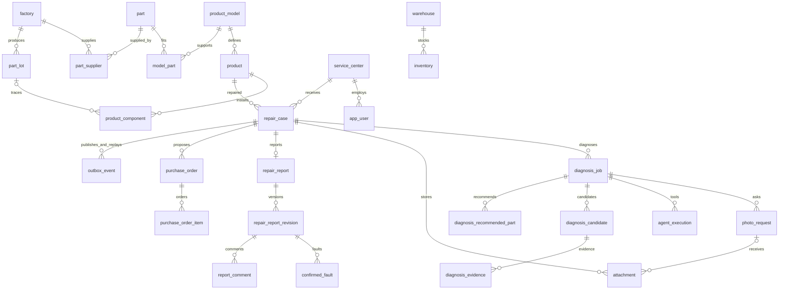

# 로봇청소기 수리 진단 — 기준 DB 설계 v2

`schema.sql`이 현재 백엔드의 정식 스키마 snapshot이다. PostgreSQL bigint identity PK, timestamptz 시각과 원래 설계의 25개 업무 테이블을 기준으로 API·서비스·쿼리를 정렬했다. 최초 설계는 [archive/README-v1.md](archive/README-v1.md), [archive/schema-v1.sql](archive/schema-v1.sql)에 보존했다.

기존 DB 업그레이드는 애플리케이션 기동 시 Flyway **V4 → V5**를 통해 수행한다. `schema.sql`은 빈 별도 DB를 검토·구축할 때만 사용하는 snapshot이며, 기존 DB에 수동 실행하지 않는다. V1~V3 마이그레이션은 변경하지 않았다. V4는 기존 UUID 테이블을 `legacy_v3`에 이동해 원본을 보존하고 기준 스키마를 만든다. V5는 bigint ID 대응표로 관계를 유지하며 데이터를 복사한다. 기존 UUID URL을 새 bigint URL로 해석하는 자동 API alias는 제공하지 않으므로 클라이언트가 새 ID를 조회해야 한다.

## 기준과 최신 요구사항

원 설계의 구조·FK·CHECK·UNIQUE·인덱스는 유지했다. 최신 요구사항과 충돌하는 원 설계 정책만 명시적으로 확장했다.

- 리포트는 확정 후에도 수정할 수 있어 revision·현재 확정 포인터·본사 코멘트를 추가했다. `repair_report`는 접수당 하나인 header이며 내용 이력은 `repair_report_revision`, 고장 이력은 revision별 `confirmed_fault`다.
- 진단 주 연동 경로는 Kafka다. 이전 문서의 AI HTTP callback과 발주 승인용 LangGraph interrupt는 사용하지 않는다. 진단 성공 후 Spring이 재고 조회·발주를 담당한다.
- 진단 원본 통합 JSON과 함께 `agent_execution`, `diagnosis_candidate`, `diagnosis_evidence`, `diagnosis_recommended_part`에 정규화된 결과를 기록한다.
- 사용자 접수 JSON, 제품 snapshot, 조달 상태를 별도로 보관한다. 도구·사용자 입력으로 서버 관리 메타데이터를 덮어쓰지 않는다.

## API와 ID

[49개 전체 API 점검표](API_AUDIT.md), [DB 추가·변경 내역](CHANGES.md), [OpenAPI](../openapi.json), [REST 상세](../API.md), [Kafka/MCP 계약](../INTEGRATION.md).

DB PK/FK는 bigint이며 API·Kafka의 업무 ID는 정밀도 손실을 막는 십진수 문자열이다. 예: `"repairId":"12"`. eventId·executionId·correlationId·requestKey·submissionKey 같은 메시지/멱등 키는 UUID다. AI 사진 요청은 UUID requestKey로 식별하고 Spring이 bigint photo_request.id를 배정한다. 재개 명령에는 DB requestId와 AI requestKey를 함께 전달한다.

로그인은 app_user.email 계정을 form 필드 username으로 전달하고 HttpOnly 세션 쿠키를 사용한다. 개발 계정 tech1/tech2/quality는 테스트용 email 식별자다. 계정의 active=false를 인증과 API 접근 양쪽에서 검사한다. frontend SSE는 세션 쿠키로 Spring에 연결하고 내부 조회는 별도 서비스 Bearer 인증을 요구한다.

## 주요 관계

## 상태와 동시성

접수 상태: RECEIVED/DIAGNOSING/WAITING_INPUT/DIAGNOSED/MANUAL_REVIEW/REPAIRING/CLOSED/CANCELLED. 진단 상태: QUEUED/RUNNING/WAITING_INPUT/SUCCEEDED/FAILED/CANCELLED. 조달 상태는 repair_case.procurement_status에서 독립 관리한다. 사람이 처리하는 REPAIRING/CANCELLED 상태는 DB에서 허용하지만 현재 별도 접수 상태 변경 API는 제공하지 않는다.

사진은 OPEN → SUBMITTED, 최대 3회. 요청·제출·재개 시 job 행을 잠근다. 재개해도 같은 job이며 input_revision/execution_id가 바뀐다. active job 부분 UNIQUE를 유지한다. 서버 retry_count와 사진 photo_request_count는 독립이다.

발주: PENDING → APPROVED → ORDERED → RECEIVED, 또는 PENDING → REJECTED/CANCELLED, APPROVED → CANCELLED. approve/reject는 품질 담당자만, cancel/ship/receive는 해당 센터 기사만 수행한다. approve는 예약, ship은 ORDERED로 전환하며 창고 현재고·예약을 차감, receive는 로컬 수령 상태 확인이다. 공장 주문도 내부 상태만 관리한다. ORDERED 이후 취소는 거절한다. 동일 상태 재요청은 효과를 중복 적용하지 않는다. 각 변경은 version 증가와 감사 로그를 동반한다.

현재 확정 리포트만 `fault_dashboard`와 API 통계에 반영한다. 새 초안은 기존 확정 통계를 유지한다. 확정 revision 변경 시 같은 접수를 중복 집계하지 않는다. 월과 기간 기준은 Asia/Seoul 확정일 [from,to)다. 고장 영역 PCB/MOTOR/SW/OTHER, 부품 분류 PCB/MOTOR/OTHER. SW는 장착 부품 없이 가능하다. 실제 장착 기간·제품 모델 호환성·부품 분류를 검증한다. 생산공장은 실제 장착 lot에서만 추적하며 불명확하면 UNKNOWN이다. 고장 없음 리포트는 faults=[] 및 outcome=NO_FAULT_FOUND를 사용할 수 있다. 생산·출하 분모가 없으므로 고장률은 제공하지 않는다.

outbox_event 한 테이블에 Kafka 명령(topic 있음)과 SSE 알림(topic NULL)을 저장한다. Kafka publisher는 topic이 있는 행만 발행하고 SSE는 topic NULL만 재생한다. 동일 접수의 이벤트 ID 배정·커밋을 잠금으로 직렬화해 늦은 커밋 누락을 막는다. 상세 운영 정책과 외부 연동 한계는 상위 문서를 참고한다.
