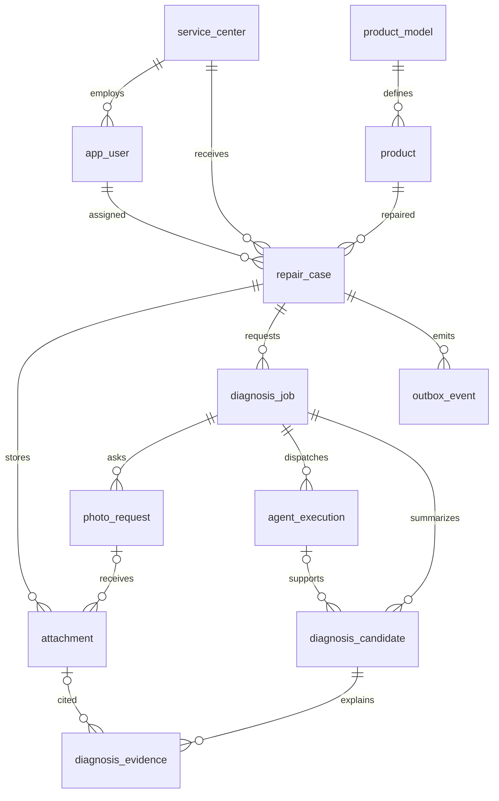
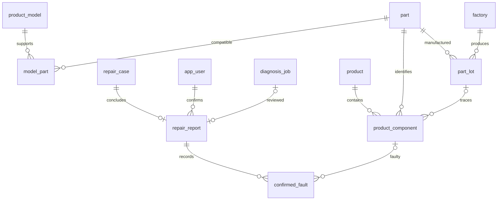
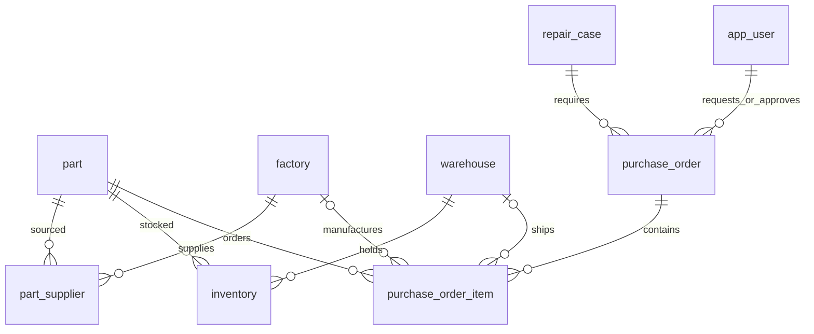

# 로봇청소기 수리 진단 Agent — 백엔드 DB 설계 v1

## 설계 전제
Spring Boot + PostgreSQL을 기준으로 한 단일 제조사 MVP다. 삼성과 실제 연동하지 않는 가상 데이터 환경이다. 첨부 역할 분담표의 백엔드 범위(로그인, 접수 API, 202+taskId, SSE 중계, 내부 API, 집계 API)에 맞췄다. 사진과 로그 원본은 객체 저장소, 관계형 데이터는 PostgreSQL, 벡터 인덱스는 RAG 담당자가 관리한다. SQL은 빈 전용 데이터베이스에서 실행하며 Flyway 초기 마이그레이션으로 옮길 수 있다.

AI 추정과 기사 확정을 분리한다. 생산지는 부품 마스터가 아니라 실제 장착 부품의 생산 lot에서 추적한다. 출처를 모르면 UNKNOWN으로 남긴다. 발주 후보 생성과 승인·주문 처리를 분리한다. MCP는 DB 접근에 필수인 기술이 아니라, 에이전트에게 업무 도구를 제공하는 인터페이스다. 이번 프로젝트에서는 MCP → 인증된 Spring 내부 API → DB 경로를 권장한다.

## ERD 1 — 접수와 비동기 진단

## ERD 2 — 확정 원인과 생산지 추적

## ERD 3 — 재고·발주

`audit_log`는 변경 주체·대상·요청 키를 보관하는 공통 감사 로그다. 범용 entity_id는 여러 테이블을 가리키므로 FK가 아니며 업무 데이터의 원본으로 사용하지 않는다.

## 테이블별 역할
|테이블|역할 및 주요 필드|
|---|---|
|service_center|센터 코드·지역·주소·연락처|
|app_user|로그인 계정, 비밀번호 해시, TECHNICIAN/QUALITY_MANAGER, 소속 센터|
|product_model|제품 모델 코드|
|product|제품 개체, 고유 시리얼, 모델, 제조일|
|part|부품 코드와 PCB/MOTOR/OTHER 분류|
|model_part|제품 모델별 호환 부품 N:M|
|factory|생산 공장 위치·전화번호|
|part_supplier|부품별 주문 가능 공장, 예상 조달일|
|part_lot|부품·공장·생산 lot 연결|
|product_component|제품에 실제 장착된 부품, 슬롯, lot, 장착/제거 시점|
|repair_case|접수 번호, 담당자, 증상, 에러 코드, 접수 당시 펌웨어|
|diagnosis_job|비동기 taskId, 멱등 키, 상태, 추가사진 횟수, 서버 재시도 횟수|
|photo_request|1~3차 추가자료 요청과 제출 상태|
|attachment|사진/로그/문서의 object_key, 해시, 크기, 대상 부위|
|agent_execution|MCP 호출 단위의 도구·모델 버전·입출력·오류|
|diagnosis_candidate|AI 원인 후보 순위, 확신도, 수리 방법, 권장 부품|
|diagnosis_evidence|사진 annotation 또는 매뉴얼 URI·버전·인용문|
|repair_report|기사의 최종 확인, 조치, AI 판단 평가; 접수당 1개|
|confirmed_fault|확정된 복수 고장; SW는 component_id 없이 기록 가능|
|warehouse|창고 위치·연락처|
|inventory|창고×부품별 현재고·예약 수량; 가용재고=현재고-예약|
|purchase_order|발주 요청·승인자·결정 시각·상태·멱등 키|
|purchase_order_item|복수 발주 품목; 창고 출고 또는 공장 주문 중 하나|
|outbox_event|업무 저장과 함께 기록하는 큐 발행 이벤트 및 SSE 재생 원본|
|audit_log|기사·관리자·시스템 서비스의 변경 이력|

모든 PK/FK, nullable, CHECK, UNIQUE, 인덱스와 전체 컬럼은 schema.sql에 정의했다. id는 bigint identity, 일시는 timestamptz다. Java Long을 JSON으로 보낼 때 프런트엔드 정밀도 손실을 막기 위해 문자열 ID 계약을 권장한다.

## 상태와 처리 규칙
### 접수
RECEIVED → DIAGNOSING → DIAGNOSED → REPAIRING → CLOSED.
추가 사진 대기에서는 WAITING_INPUT, 진단 실패에서는 MANUAL_REVIEW로 전환한다. 사람이 수리하는 절차는 AI 진단 실패와 별개로 계속할 수 있다. CANCELLED는 별도 종료 경로다.

### 비동기 진단
QUEUED → RUNNING → SUCCEEDED/FAILED. 추가 사진 필요 시 RUNNING → WAITING_INPUT → QUEUED로 같은 job을 재개한다. LangGraph 체크포인트 저장소는 AI 서버 담당이며 checkpoint_ref로 연결한다. RUNNING 작업은 lease를 갱신하고 만료 시 작업 회수 정책을 적용한다.

초기 사진은 횟수에서 제외한다. 1·2·3차 추가 요청을 제출받아 재분석할 수 있다. 3차 제출 후에도 확신이 부족하면 FAILED 및 MANUAL_REVIEW로 전환하고 4차 요청은 만들지 않는다. WAITING_INPUT 중에는 큐 소비 스레드를 잡고 있지 않는다. 사진 미제출 만료 시에는 업무 정책에 따라 수동 검토로 넘긴다. 서버 오류의 retry_count는 사진 요청 횟수에 영향을 주지 않는다.

### 발주
PENDING → APPROVED → ORDERED → RECEIVED 또는 PENDING → REJECTED. AI는 제안/PENDING 생성까지만 한다. QUALITY_MANAGER만 승인·거절할 수 있다. 승인 API는 로그인 주체를 사용하고 요청 본문의 approvedBy 같은 값을 신뢰하지 않는다. 승인과 진단 상태는 독립적이다. 승인 대기로 그래프를 중단하려면 purchase_order.id를 체크포인트와 연결하고 승인 확정 이벤트로 재개한다.

## DB와 서비스 계층의 책임
SQL CHECK는 허용 값과 행 단위 제약을 검증한다. 아래 업무 규칙은 CHECK만으로 보장되지 않으므로 반드시 Spring 서비스에서 트랜잭션으로 검증한다.

- 기사 접근은 본인 센터, 품질 담당자는 전체 센터로 제한한다. 배정 기사와 접수 센터 일치 여부도 확인한다.
- 첨부 request_id의 job이 같은 case에 속하는지, 인용 사진이 해당 진단 case에 속하는지 확인한다.
- 장착 부품은 모델 호환성, 고장 발생 당시 장착 기간, 고장 분류와 부품 분류를 확인한다.
- 사진 요청 생성 시 job 행을 잠그고 count<3 및 RUNNING을 확인한다. count 증가·요청 생성·WAITING_INPUT·이벤트 저장을 한 트랜잭션으로 수행한다.
- 보고서는 해당 case의 진단만 연결한다(복합 FK 포함). 보고서·확정고장·완료 이벤트를 함께 저장한다. FIXED인데 미확정인 경우처럼 결과와 확정 원인 수가 다를 수 있으므로 0개도 허용한다.
- 최종 보고서는 확정 후 불변을 기본으로 한다. 수정이 필요하면 감사 로그와 수정 API를 도입한다. 본 버전은 보고서 버전 테이블을 제공하지 않는다.
- 승인 시 PENDING 여부와 관리자 역할을 검사한다. 창고 출고는 inventory를 잠그고 가용 수량을 확인한 후 예약한다. 취소 시 예약 해제, 출고 시 on_hand와 reserved를 함께 차감한다. 예약의 중복 실행을 막도록 주문 상태 변경과 같은 트랜잭션으로 수행한다.
- 승인 후 품목을 변경할 수 없다. 승인 전 변경·취소·출고는 모두 명시적 상태 전이와 version 조건으로 처리한다. ORDERED 이후 취소는 이 MVP에서 지원하지 않는다.
- 제품·부품·생산공장 마스터는 참조가 생기면 삭제하지 않는다. 계정은 active=false로 비활성화한다.
- DB 계정은 Spring만 업무 테이블을 변경하고 FastAPI/분석 도구에는 직접 쓰기 계정을 제공하지 않는다. 감사 기록도 변경 API에서 같은 트랜잭션으로 기록한다.

## API 계약 초안
|API|목적|
|---|---|
|POST /api/auth/login|인증, 역할 포함 토큰 반환|
|POST /api/repairs|접수 생성|
|POST /api/repairs/{id}/attachments|업로드 완료 확인 후 첨부 메타데이터 등록|
|POST /api/repairs/{id}/diagnoses|Idempotency-Key를 받아 202, taskId 반환|
|GET /api/tasks/{id}|진단 상태와 사진 요청 조회|
|GET /api/repairs/{id}/events|SSE; Last-Event-ID로 누락 이벤트 재생|
|POST /api/photo-requests/{id}/submit|첨부 검증 후 SUBMITTED·작업 재개 이벤트 기록|
|GET /api/repairs/{id}/diagnosis|정렬된 후보·근거·권장 부품 조회|
|POST /api/repairs/{id}/report|기사 확정 결과와 실제 조치 저장|
|POST /api/repairs/{id}/orders|PENDING 발주 제안|
|POST /api/orders/{id}/approve|품질 담당자 승인 및 창고 수량 예약|
|POST /api/orders/{id}/reject|품질 담당자 거절|
|GET /api/dashboard/faults|기간·부품·센터·생산공장별 집계|

내부 API는 서비스 인증을 적용한다. MCP의 business/rag 도구와 FastAPI 콜백만 사용한다.

|내부 API 예시|소유·책임|
|---|---|
|GET /internal/products?serialNumber=...|제품·장착 부품·lot 조회|
|GET /internal/parts/{id}/availability|가용재고·창고·공장·전화번호 조회|
|GET /internal/fault-cases|확정 보고서만 유사 사례 검색 대상으로 제공|
|POST /internal/tasks/{id}/agent-results|call_key 기준 중복 방지; 호출·후보·근거 저장|
|POST /internal/tasks/{id}/photo-requests|횟수 검증, 대기 상태 전환|
|POST /internal/tasks/{id}/complete|진단 최종 상태 전환; 실패면 수동 검토|
|POST /internal/orders/proposals|AI 발주 제안; 승인 필드는 수신하지 않음|
|POST /internal/confirmed-faults/publish|기사 확정된 reportId를 받아 지식화 이벤트 기록|

마지막 API는 AI가 확정 원본을 자유롭게 덮어쓰는 기능이 아니다. 원본은 기사 보고서이고, AI는 이를 정규화해 RAG 인덱스 반영을 요청한다. 서비스는 reportId의 존재와 확정 상태를 확인한다. RAG 저장소는 reportId로 upsert하고 재시도한다.

## 큐·SSE·멱등성
접수 후 diagnosis_job 생성과 DIAGNOSIS_REQUESTED outbox 삽입을 한 트랜잭션에 커밋한 다음 202를 반환한다. 발행기는 미발행 이벤트를 큐에 보내고 published_at을 갱신한다. 큐는 중복 전달될 수 있으므로 요청 UUID, call_key와 상태/version 조건으로 멱등성을 구현한다. 같은 요청 키로 다른 case나 본문을 보내면 409를 반환한다. 장기 실행 중복을 막기 위해 작업 claim과 lease 갱신이 필요하다.

SSE는 DB 이벤트 ID를 id로 사용한다. 재연결 시 case와 권한을 검증하고 Last-Event-ID 이후 이벤트를 조회한다. 모든 외부 도구 응답에 taskId와 callKey를 포함하고 종료된 job의 늦은 콜백은 거부한다. 브라우저 이벤트에는 모델 원시 입출력·민감 정보를 그대로 노출하지 않는다. UI는 SSE 도착 시 GET 조회로 최신 상태를 확인한다. outbox를 정리할 경우 재생 보존기간과 전체 상태 재조회 정책을 함께 정의한다.

권장 이벤트: DIAGNOSIS_REQUESTED, DIAGNOSIS_STARTED, PHOTO_REQUESTED, PHOTO_SUBMITTED, DIAGNOSIS_COMPLETED, DIAGNOSIS_FAILED, ORDER_APPROVED, ORDER_REJECTED, REPORT_CONFIRMED.

## 대시보드와 데이터 활용
fault_dashboard 뷰는 기사 확정 보고서를 기준으로 월·센터·부품·생산공장·고장 영역별 DISTINCT 접수 수를 집계한다. 월의 기준은 confirmed_at이며 DB 세션 TimeZone을 Asia/Seoul로 고정한다. 접수 월로 보고 싶으면 쿼리를 별도로 제공한다.

동일 접수에서 서로 다른 부품 고장은 각 부품 그룹에 집계되므로 그룹별 숫자의 합계는 전체 접수 건수와 다를 수 있다. 같은 부품의 원인 중복은 그룹 내 DISTINCT로 제거한다. lot 미확인과 SW는 UNKNOWN 생산지로 나타난다. 본 뷰는 현재 공장 지역명을 사용하므로 지역명 변경 전후의 스냅샷을 보존하지 않는다.

'고장 건수'만으로 생산지 품질을 단정할 수 없다. 고장률을 계산하려면 기간별 생산·출하·장착 대수와 관찰기간 같은 분모 데이터가 추가로 필요하다. 현 설계의 dashboard 명칭은 고장 빈도/수리 접수 건수로 한다. AI confidence는 보정된 확률로 가정하지 않는다.

품질 개선에는 확정 원인·부품 lot·펌웨어·실제 조치·AI 판단 일치도를 활용한다. RAG에는 확정 보고서만 반영하고 미확정 AI 후보는 학습 정답으로 취급하지 않는다.

## 구현 순서와 범위
1. 마스터와 가상 데이터: 센터·사용자·제품·부품·공장·lot·장착 부품·창고·재고.
2. 접수·파일 업로드·job·outbox·진행 상태·SSE.
3. 내부 콜백·후보·근거·추가사진 3회 제한.
4. 기사 보고서·발주 승인·재고 예약·대시보드.

MVP는 단일 제조사, 접수당 최종 보고서 1개, 승인 결정 1회, 품목별 단일 조달처다. 다중 고객사 SaaS, 부분입고, 재고 이동 원장, 장기 예약 만료, 복수 승인 단계, 보고서 개정 이력, 문서 청크/벡터 저장소는 확장 범위다. 실제 운영 전에는 재고 이동 원장과 접근·보존 정책을 보강한다.

## 검증 범위
이 문서와 SQL은 제안 설계다. 별도 PostgreSQL 인스턴스에서 마이그레이션과 동시성 통합 테스트를 수행해야 한다. 핵심 테스트는 동일 Idempotency-Key 중복 요청, 4차 사진 요청 거부, 중복 콜백 무시, 다른 case의 자료 연결 거부, 동시 승인 시 재고 초과 예약 방지, 종료 작업의 늦은 콜백 거부다.
